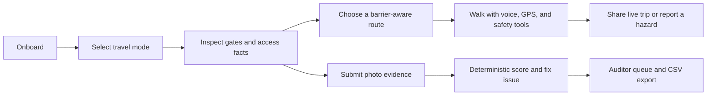

<div align="center">
  
  <h1>SugamPath</h1>
  <p><strong>Accessibility intelligence for the journeys between the map pins.</strong></p>
  <p>
    Find a usable gate, choose a route that respects mobility needs, share a live walk,
    and turn evidence into action.
  </p>
  <p>
    <a href="#quick-start">Quick start</a> ·
    <a href="#what-it-does">What it does</a> ·
    <a href="#supabase-setup">Supabase setup</a> ·
    <a href="#project-structure">Project structure</a>
  </p>
</div>

---

## Why SugamPath exists

A route can be short and still be unusable. A station can have a ramp while its only open gate has steps. A tactile path can disappear behind a parked scooter. SugamPath treats these details as routing data, not footnotes.

SugamPath is a progressive web app for accessible travel and civic accessibility audits. It combines gate-level access information, barrier-aware routing, live walking safety tools, community evidence, and an auditor workspace in one calm interface.

> **Current pilot:** Thapar University campus in Patiala. The repository also contains reference layouts and sample records for New Delhi and Chandigarh, but the live campus data pipeline is currently configured for Patiala.

## What it does

### For travellers

- **Choose for your body and route.** Wheelchair, blind or low-vision, walker, and standard travel modes produce different scores and route decisions.
- **Compare gates and facilities.** See step-free access, ramps, lifts, doorway width, tactile paving, confidence, source, and last-audited time.
- **Use barrier-aware routing.** Routes account for steps, ramps, tactile coverage, rough surfaces, crossings, and annotated obstacles instead of optimising distance alone.
- **Walk with confidence.** Start step-by-step navigation with voice guidance, live GPS, slope and effort cues, surface sensing, hazard reporting, arrival checks, and an offline cache.
- **Share a live trip.** Generate a `/track/<token>` link that a caregiver can open without an account. SOS state and trip updates sync locally across browser tabs or through Supabase.
- **Ask “What’s ahead?”** Send one camera frame for short spoken guidance. You can use a self-hosted OpenAI-compatible vision endpoint, Gemini, or an optional Groq vision fallback. Without a configured key, the app uses a clearly labelled sample response.
- **Contribute local knowledge.** Mark accessible places, confirm or dispute community reports, and upload tagged road photos when community SQL and authentication are configured.

### For auditors and city teams

- **Work from a ranked fix list.** Filter accessibility issues by city and status, inspect proof, and update the remediation state.
- **Turn photos into structured findings.** The vision flow extracts access, surface, tactile, obstruction, crossing, ramp, and lift observations.
- **Keep scoring deterministic.** AI reads the image; TypeScript applies the scoring rules, confidence threshold, caps, and issue severity deductions.
- **Export the queue.** Download a CSV of issues for coordination outside the app.
- **Generate evidence-aware reports.** The legal reporting flow separates structural and municipal tracks and applies an eligibility gate before a report can be recorded.

### Designed for access

- English, Hindi, and Punjabi (Gurmukhi)
- Large and extra-large text
- High contrast and reduced motion
- Voice guidance and a visual-only option
- Keyboard-friendly controls, labelled landmarks, and generous touch targets
- Installable PWA with offline-aware behaviour

## Product flow



## Quick start

### Requirements

- Node.js 20 or newer
- npm
- A Supabase project for the live campus map and remote persistence
- Optional: a Gemini or Groq vision key for real “What’s ahead?” responses

### Run locally

```bash
git clone <your-repository-url>
cd SugamPath
npm install
npm run dev
```

Open [http://localhost:3000](http://localhost:3000).

The local backend keeps trip state in `localStorage` and synchronises open tabs with `BroadcastChannel`. The interface can be explored without an AI key. The live campus places, network, and barriers require the Supabase setup below.

### Useful commands

| Command | Purpose |
| --- | --- |
| `npm run dev` | Start Vite on port `3000` and expose it to the local network |
| `npm run build` | Create the production bundle and PWA service worker |
| `npm run preview` | Serve the production bundle locally |
| `npm run lint` | Run TypeScript with `--noEmit` |
| `npx tsx scripts/selfcheck-pulse.ts` | Check surface, stairs, fall, hazard, and recurrence classifiers |
| `npx tsx scripts/selfcheck-legal.ts` | Check the legal eligibility and evidence gate |

## Configuration

Copy the example file when you need server or database features:

```bash
cp .env.example .env.local
```

Use public/publishable Supabase credentials in the browser. Never put a service-role key in a `VITE_*` or `NEXT_PUBLIC_*` variable.

```dotenv
# Browser: either naming convention is supported.
NEXT_PUBLIC_SUPABASE_URL=https://your-project.supabase.co
NEXT_PUBLIC_SUPABASE_PUBLISHABLE_KEY=your-publishable-key
# Or use VITE_SUPABASE_URL and VITE_SUPABASE_ANON_KEY.

# Optional self-hosted OpenAI-compatible vision endpoint. This is tried first.
LLM_BASE_URL=https://your-llm.example/v1
LLM_API_KEY=your-llm-key
LLM_MODEL=your-vision-model

# Optional Gemini fallback.
GEMINI_API_KEY=your-gemini-key

# Optional Groq fallback. Both values are required for the fallback.
GROQ_API_KEY=your-groq-key
GROQ_VISION_MODEL=your-groq-vision-model

# Optional when the API is hosted separately. Leave empty for the local
# Vite API middleware or same-origin Vercel deployment.
VITE_API_BASE=
```

The AI keys and the optional self-hosted endpoint credentials are read by the server-side API helper in `api/_ai.ts`; they are not exposed through the browser bundle. Providers are tried in this order: custom OpenAI-compatible endpoint, Gemini, then Groq. `.env*` files are ignored by Git, except `.env.example`.

## Supabase setup

The SQL files are intentionally split by responsibility. Run them in this order in the Supabase SQL editor:

```text
1. seed.sql                         # Patiala places, gates, paths, annotations, and RPCs
2. routing.sql                      # pgRouting route functions and read policies
3. supabase/routing_barriers.sql   # Barrier-aware replacement route function
4. supabase/schema.sql              # Trips, hazards, samples, arrival, and legal reports
5. supabase/community.sql           # Optional auth, marks, votes, photos, and storage
```

`seed.sql` is generated campus data and is safe to re-run according to its header. `routing.sql` enables `pgrouting`; `seed.sql` enables `postgis`. If your project does not allow the extensions, enable them from **Database → Extensions** first.

Then add the public Supabase variables to `.env.local` and restart Vite. The app discovers the Supabase client automatically from either supported variable naming convention in `src/lib/supabase.ts`.

### Community layer

`supabase/community.sql` is optional. It enables:

- email or magic-link authentication for contributions
- accessible-place marks with confirm/dispute votes
- road-photo uploads in the `road-photos` storage bucket
- row-level security and realtime updates

For a deployed app, add the site URL and local development URL under **Authentication → URL Configuration** in Supabase before testing magic links.

### Backend design

All remote writes pass through the `SugamBackend` interface in `src/services/backend/types.ts`. The app starts with a local backend and automatically wraps a remote backend with an offline outbox. This keeps trip updates, SOS events, surface samples, hazard reports, arrival checks, and legal report records ordered while connectivity returns.

The live campus data hook also caches the latest good network, place, gate, and barrier data in `localStorage`. It refreshes on visibility changes, on a timer, and through Supabase Realtime when the relevant tables are published.

For a deeper backend walkthrough, read [`docs/BACKEND.md`](docs/BACKEND.md).

## Architecture

```text
React 19 + Vite + TypeScript
├── Traveller experience
│   ├── gate and place intelligence
│   ├── campus map and PostGIS/pgRouting routes
│   ├── live navigation, voice, GPS, and safety tools
│   └── community marks and road photos
├── Auditor experience
│   ├── photo audit wizard
│   ├── deterministic accessibility scoring
│   ├── fix list and status history
│   └── legal eligibility and CSV export
├── Local-first services
│   ├── localStorage + BroadcastChannel backend
│   ├── IndexedDB/localStorage safety cache
│   └── offline write outbox for remote backends
└── Optional services
    ├── Supabase Auth, Postgres, Realtime, Storage, and RPCs
    └── Vercel/Vite API → Gemini or Groq vision
```

### Score model

The photo audit does not let a language model decide the final accessibility score. The pipeline is:

1. The vision provider returns structured findings and confidence.
2. `src/lib/scoring.ts` applies fixed deductions for barriers, surfaces, lifts, ramps, tactile paving, crossings, and obstructions.
3. Mode-specific caps and a confidence threshold determine the label.
4. High-severity findings can create an auditor issue with photo evidence and an audit trail.

This makes the score repeatable and keeps uncertainty visible through `verified`, `ai_estimate`, `not_verified`, and `unrated` labels.

## Project structure

```text
.
├── api/                  Serverless AI endpoint and provider helper
├── docs/                 Backend integration notes
├── public/               PWA icons and static assets
├── scripts/              Deterministic self-checks
├── src/
│   ├── components/       Traveller, auditor, campus, community, and safety UI
│   ├── data/              Reference layouts and sample audit data
│   ├── hooks/             Campus, community, GPS, PWA, and walking-session hooks
│   ├── lib/               Routing, scoring, i18n, safety, auth, and backend logic
│   ├── services/backend/  Local, Supabase, and offline-outbox adapters
│   └── types/             Shared accessibility and safety models
├── supabase/              Backend schema, routing barriers, and community SQL
├── seed.sql               Patiala campus data and read-side RPCs
├── routing.sql            pgRouting functions and policies
└── vite.config.ts         Vite, PWA, local API middleware, and asset handling
```

## Deployment

### Vercel

The repository includes `vercel.json` for SPA fallback routing and the `api/` directory for the `/api/whats-ahead` serverless endpoint.

1. Import the repository into Vercel.
2. Add the Supabase public variables.
3. Add `GEMINI_API_KEY` and, optionally, `GROQ_API_KEY` plus `GROQ_VISION_MODEL` as server environment variables.
4. Deploy.

The caregiver view is available at:

```text
https://your-domain.example/track/<token>
```

The token is the access secret for that trip. Do not post live trip links publicly.

### Other hosts

Run `npm run build` and serve `dist/` as a single-page application. Configure all non-API routes to fall back to `index.html`. If the host does not run the `api/` functions, deploy the API separately and set `VITE_API_BASE` to its origin.

## Safety and privacy notes

SugamPath supports travel decisions and evidence collection. It is not a replacement for local knowledge, a trained mobility professional, or emergency services. Confirm conditions at the time of travel, especially where data is marked as estimated or unaudited.

- Emergency contact details are stored on the device by default.
- SOS actions open the phone’s call, SMS, or WhatsApp flows; they do not guarantee delivery.
- A live-trip link can expose the trip state to anyone who has the token.
- Supabase anonymous writes in the starter schema are suitable for a pilot, not a finished abuse-resistant production deployment. Review the TODO in `supabase/schema.sql`, add retention, and tighten write authorisation before launch.
- Keep API secrets server-side and rotate any key that is accidentally exposed.

## Contributing

Small, focused changes are easiest to review. Before opening a pull request:

```bash
npm run lint
npm run build
npx tsx scripts/selfcheck-pulse.ts
npx tsx scripts/selfcheck-legal.ts
```

When changing accessibility rules, update the relevant deterministic self-check rather than relying only on a visual test.

## License

No license file is currently included. Add a license before distributing SugamPath outside the project or accepting external contributions.
