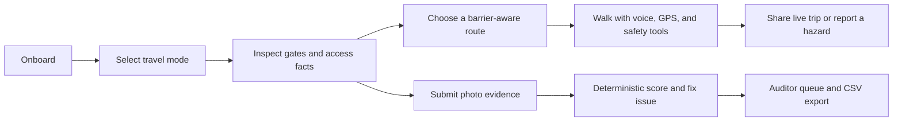

<div align="center">
  
  <h1>SugamPath</h1>
  <p><strong>Accessibility intelligence for the journeys between the map pins.</strong></p>
  <p>
    Find a usable gate, choose a route that respects mobility needs, share a live walk,
    and turn evidence into action.
  </p>
  <p>
    <a href="#quick-start">Quick start</a> ·
    <a href="#what-it-does">What it does</a> ·
    <a href="#feature-guide">Feature guide</a> ·
    <a href="#supabase-setup">Supabase setup</a> ·
    <a href="#project-structure">Project structure</a>
  </p>
</div>

---

## Why SugamPath exists

A route can be short and still be unusable. A station can have a ramp while its only open gate has steps. A tactile path can disappear behind a parked scooter. SugamPath treats these details as routing data, not footnotes.

SugamPath is a progressive web app for accessible travel and civic accessibility audits. It combines gate-level access information, barrier-aware routing, live walking safety tools, community evidence, and an auditor workspace in one calm interface.

> **Current pilot:** Thapar University campus in Patiala. The repository also contains reference layouts and sample records for New Delhi and Chandigarh, but the live campus data pipeline is currently configured for Patiala.

## What it does

### For travellers

- **Choose for your body and route.** Wheelchair, blind or low-vision, walker, and standard travel modes produce different scores and route decisions.
- **Compare gates and facilities.** See step-free access, ramps, lifts, doorway width, tactile paving, confidence, source, and last-audited time.
- **Use barrier-aware routing.** Routes account for steps, ramps, tactile coverage, rough surfaces, crossings, and annotated obstacles instead of optimising distance alone.
- **Walk with confidence.** Start step-by-step navigation with voice guidance, live GPS, slope and effort cues, surface sensing, hazard reporting, arrival checks, and an offline cache.
- **Share a live trip.** Generate a `/track/<token>` link that a caregiver can open without an account. SOS state and trip updates sync locally across browser tabs or through Supabase.
- **Ask “What’s ahead?”** Send one camera frame for short spoken guidance. You can use a self-hosted OpenAI-compatible vision endpoint, Gemini, or an optional Groq vision fallback. Without a configured key, the app uses a clearly labelled sample response.
- **Contribute local knowledge.** Mark accessible places, confirm or dispute community reports, and upload tagged road photos when community SQL and authentication are configured.

### For auditors and city teams

- **Work from a ranked fix list.** Filter accessibility issues by city and status, inspect proof, and update the remediation state.
- **Turn photos into structured findings.** The vision flow extracts access, surface, tactile, obstruction, crossing, ramp, and lift observations.
- **Keep scoring deterministic.** AI reads the image; TypeScript applies the scoring rules, confidence threshold, caps, and issue severity deductions.
- **Export the queue.** Download a CSV of issues for coordination outside the app.
- **Generate evidence-aware reports.** The legal reporting flow separates structural and municipal tracks and applies an eligibility gate before a report can be recorded.

### Designed for access

- English, Hindi, and Punjabi (Gurmukhi)
- Large and extra-large text
- High contrast and reduced motion
- Voice guidance and a visual-only option
- Keyboard-friendly controls, labelled landmarks, and generous touch targets
- Installable PWA with offline-aware behaviour

## Product flow



## Feature guide

SugamPath is more than an accessible map. It connects discovery, route planning, live safety, community evidence, and civic follow-through.

### Two experiences, one data model

| Role | Built for | Main workspace |
| --- | --- | --- |
| **Traveller** | People choosing and taking an accessible journey | Home, Best Route, Community / Check Photo |
| **Auditor** | Campus teams, city teams, civic groups, and inspectors | Fix List and Demo Guide |

The active pilot is **Thapar University, Patiala**. Traveller and auditor profiles, language, accessibility preferences, emergency details, and passive-mapping consent are saved locally so the experience returns where the user left it.

### Onboarding that adapts to the traveller

The first-run flow supports English, Hindi, and Punjabi in Gurmukhi. It includes translated interface copy, route instructions, voice prompts, safety messages, community labels, audit labels, and the caregiver view.

Users can:

- Listen to each onboarding screen with device speech synthesis.
- Stop speech, hear sample pronunciations, and use browser speech recognition where available.
- Choose **Traveller** or **Auditor**. Traveller onboarding has four steps; auditor onboarding has three.
- Choose **Blind or low vision**, **Wheelchair**, **Walker or elder**, or **Standard walking**.
- Select the Patiala campus, take a short tour, skip onboarding, or replay the guide later.
- Use clickable choices when microphone or speech recognition support is unavailable.

Each assistance mode changes more than a label:

| Mode | How the product responds |
| --- | --- |
| **Blind / low vision** | Voice-first controls, large touch targets, spoken route steps, eyes-free gestures, tactile-path preferences, and voice commands. |
| **Wheelchair** | Step-free routes, wheelchair-blocking barriers excluded, and extra attention to ramps, lifts, steps, and surfaces. |
| **Walker / elder** | Extra weight for steps, rough surfaces, steep paths, crossings, turns, and barriers, with larger text enabled by default. |
| **Standard** | Neutral pedestrian routing and visual navigation by default, without automatic voice output. |

### Personal accessibility controls

The Preferences modal brings the whole experience together. It includes:

- Large and extra-large text
- High contrast
- Voice on/off
- Visual-only mode
- Reduced motion
- Emergency contact management
- Passive surface mapping on/off
- Traveller/auditor role switching
- Welcome-guide replay
- PWA installation
- Offline simulation for demos and testing

The app also supports semantic landmarks, labelled buttons, searchable ARIA comboboxes, keyboard navigation, visible focus rings, `aria-live` updates, accessible progress values, and Escape-to-close behaviour. It respects the operating system’s reduced-motion preference.

### Home: choose a place and a usable entrance

The Home screen provides the active city and mode context, multilingual place search, and a compact way to compare destinations. Search matches English, Hindi, Punjabi, partial place names, and city names. The first five places are shown initially, with an option to expand the full list.

Every place can show:

- Mode-specific score: **Good** `75–100`, **Fair** `40–74`, **Poor** `1–39`, **Blocked** `0`, or **Unrated**.
- Separate wheelchair, blind, and walker scores, with standard mode calculated from available scores.
- Trust labels: **Verified**, **AI estimate**, **Not verified**, or **Unrated**.
- Source, confidence, last-audited time, local path facts, surface coverage, barriers, steps, and mapped-data coverage.

The recommended gate is ranked for the active mode and can show its name, score, step-free status, ramp, lift and lift-working state, tactile paving, step count, trust label, and evidence photo. Three quick clue cards make the decision visible at a glance: ramp, lift, and steps.

From a place, a traveller can route there, start from there, start navigation when a route exists, read the place summary aloud, inspect all gates, inspect nearby buses, or confirm/dispute whether the recommended entrance was helpful. A session limits repeat voting on the same gate, and enough confirmations can promote a gate to verified.

The All Gates sheet includes every entrance and its mode score, trust label, step-free state, lift state, steps, and proof. The Nearby Buses sheet includes route number, stop, agency data when present, and wheelchair accessibility as **yes**, **some vehicles**, **no**, or **unknown**.

### Campus map: route around real barriers

The Best Route experience uses MapLibre and can display:

- Campus roads, footpaths, pedestrian paths, connectors, places, barriers, and the selected route
- The shortest-route comparison, live user position, and tactile-paving overlay for blind mode
- Street or satellite style, zoom, navigation, scale, labels, and automatic route framing
- Routable and non-routable place markers, origin and destination markers
- Searchable From and To selectors with keyboard navigation, validation, clear controls, and warnings for places without connected entrances
- Use-my-location, nearest routable place selection, and endpoint swapping
- Loading, no-route, error, retry, and clear-route states

Selecting a path segment exposes its type, surface, width, steps, kerb ramp, tactile paving, obstruction, barrier type, wheelchair-blocking state, length, mode scores, confidence, and whether it is blocked for the selected mode. Paths are colour-coded by accessibility score, low-confidence segments are softened, steps use dashed rendering, and barrier annotations appear as warnings.

The map can compare the accessibility-aware route as a solid highlighted line with the standard shortest route as a dashed line. Blind mode adds a tactile overlay for fully or partially covered segments.

### Mode-aware routing, not distance-only routing

The campus router changes its cost model by mode:

- **Wheelchair:** removes wheelchair-blocking barriers from consideration and prioritises step-free paths, usable gates, and accessible surfaces.
- **Blind / low vision:** prefers tactile paving, pedestrian ways, footways, and audible crossings while penalising missing tactile paving, barriers, and unsuitable road crossings.
- **Walker:** penalises barriers, steps, rough surfaces, crossings, turns, and excessive slope.
- **Standard:** uses the standard pedestrian network cost without the full accessibility weighting.

Narrated instructions are available in all three languages and include heading, turns, bearing, crossings, signal conditions, gate actions, and arrival. Warnings can call out barriers, steps, rough or unpaved surfaces, reported obstructions, unaudited segments, and crossing conditions. Route effort can account for distance, stairs, slope, surface smoothness, crossings, turns, gate hazards, structural barriers, maintenance hazards, peak-hour hazards, and transient hazards.

### Live walking navigation

Starting a route creates a walking session with a full-screen navigation experience. It includes high-accuracy GPS, accuracy, heading or derived heading, a live position marker, route projection, distance travelled, distance remaining, current and next steps, progress, ETA, battery when supported, and a route caution list.

The live map shows completed route in grey, remaining route in blue, step markers, destination, user position, nearby barriers, and direction. Users can follow the camera, switch to heading-up mode, recenter, switch map style, mute speech, expand or inspect steps, stop navigation, run a demo walk, or trigger SOS. Manual drag, rotate, or zoom pauses camera following until the user recentres.

The app detects on-route, slightly off-route, and far-from-route movement. It can speak an off-route message, offer a return-to-route action, and start a virtual demo walk when the user is too far from the campus network. Demo walking is useful for presentations and testing without physically travelling the route.

### Blind and low-vision walking mode

Blind mode switches to a deliberately simple black-and-yellow, eyes-free screen with very large instructions and distance, step count, vibration/audio feedback, and a hold-to-exit control.

- **Single tap:** repeat the instruction, announce distance, play a directional ping, and vibrate.
- **Hold for about 1.5 seconds:** listen for a command, or fall back to the camera assistance flow.
- **Triple tap:** begin the SOS countdown.
- **Hold for about four seconds:** trigger SOS directly.
- **Keyboard fallback:** Space/Enter repeats, Right Arrow or `N` advances, and `L` starts listening.

Voice commands can report stairs, rough ground, a broken lift, or a blocked path; ask where the gate is or what is ahead; repeat guidance; or advance to the next step. English, Hindi, and Punjabi keywords are supported.

### “What’s ahead?” camera assistance

A blind or low-vision traveller can open the rear camera, capture one frame, and receive short spoken guidance. The camera is downscaled, sent for analysis, and stopped after the frame; SugamPath does not use a continuous video stream.

The response identifies what is ahead, names the side of an obstacle, suggests a direction, and never claims that a route is completely safe. It can classify stairs, missing ramps, rough surfaces, broken lifts, blocked paths, vendors, parked vehicles, and other hazards. Results are spoken in English, Hindi, or Punjabi and can become a live caution on the current route.

Vision providers run server-side in this order:

1. Custom OpenAI-compatible endpoint
2. Gemini
3. Groq vision fallback

If no provider is configured, the local backend returns a clearly labelled sample response so the flow can still be demonstrated.

### Walking safety and recovery

#### Emergency and SOS

A user can save a validated emergency contact locally. SOS uses an eight-second countdown with a large cancel surface, voice and vibration feedback where supported, and a deliberate hold to confirm **I am safe**. It can be triggered manually or by a possible fall.

After SOS, the user can call the saved contact, call emergency number **112** when no contact is saved, open WhatsApp online, send SMS offline, or mark themselves safe. The browser may also attempt wake lock during a walk and restore it when the page becomes visible. Battery percentage is included when the Battery API is available.

Fall detection looks for a high acceleration spike followed by stillness. It is a heuristic, not guaranteed medical or emergency detection.

#### Pocket-Pulse surface sensing

Motion sensors and GPS can classify smooth ground, rough ground, stairs, footsteps, and a possible fall. Readings can add hazards, improve surface estimates, update route smoothness, and become anonymous backend samples when passive mapping is enabled. Passive mapping is on by default but can be disabled. These first-pass classifiers should be tuned with field data before safety-critical reliance.

#### Live hazards and arrival checks

Hazards can come from seed data, arrival checks, voice reports, camera assistance, motion sensing, community reports, or the backend. Supported types include stairs, no ramp, rough surface, broken lift, blocked path, vendor, parked vehicle, and other.

- **Structural hazards** such as stairs and no ramp do not automatically expire.
- **Maintenance hazards** such as rough surfaces and broken lifts expire after roughly 14 days unless updated.
- **Transient hazards** such as vendors and parked vehicles expire after roughly three hours.
- Repeated evening reports can surface a recurring blockage during the approximately 5–8 PM peak window.

When the traveller arrives, SugamPath asks **“Is this gate step-free?”** with two large Yes/No actions. Yes confirms the gate and sends an arrival check. No disputes it, creates a temporary blocked-path or broken-lift caution, and queues the report when offline. Blind users receive a full-screen eyes-free version.

#### Offline walk recovery

Before walking, SugamPath caches route steps, instructions, gate and destination, cautions, bearings, emergency contact, and trip token. If the page is interrupted or the connection drops, the user can resume or dismiss the saved walk. Remote writes are queued and replayed in order when connectivity returns.

### Walk-With-Me caregiver sharing

Every walk can produce a private `/track/<token>` link. The traveller can use the native share sheet, open WhatsApp to the saved contact, or copy the link. The caregiver view needs no account, app, onboarding, or installation.

It shows:

- Walking, arrived, ended, or SOS state
- SOS reason, timestamp, and safe confirmation
- Traveller label, destination, gate, route title, progress, current instruction, and battery
- Current GPS position, time since last update, route cautions, and a Google Maps link

The local backend stores the last 20 trips and synchronises browser tabs with `BroadcastChannel`. With Supabase, trip state is persisted remotely, broadcast in realtime, and polled every few seconds by the caregiver page.

### Community: local knowledge from local walkers

The Community area is split into **Explore**, **Contribute**, and **AI Check**. The hero can show place marks, road photos, and contributor counts. Explore supports map, feed, and photo views with filters for all, friendly, partial, and not-friendly places.

Community marks include a place, map location, verdict, mobility modes, accessibility features, contributor, relative time, note, and confirm/dispute counts. Feature tags include step-free entrance, ramp, lift, wide door, accessible toilet, tactile paving, smooth path, handrail, audible signal, seating, accessible parking, and low counter.

Signed-in users can confirm or dispute other people’s marks, toggle their vote, see trusted or mixed status, route from a mark linked to a campus place, and delete their own marks or photos with a second confirmation. Users cannot vote on their own marks. Supabase Realtime can refresh the feed when marks, votes, or photos change.

Contribution levels track 0, 1, 4, 10, and 25 contributions and show personal mark count, photo count, current level, and progress to the next level.

#### Mark an accessible place

The four-step Mark Place wizard supports known-place search, map selection, dropped or draggable pins, current location, a two-character minimum name, friendly/partial/not-friendly verdict, supported modes, feature tags, a 500-character note, preview, back, forward, and submit.

#### Upload road accessibility photos

Signed-in users can take a rear-camera photo or choose one from the gallery, retake it, add tags such as footpath, crossing, ramp, steps, obstruction, damage, kerb, and lighting, attach or remove GPS, see accuracy, and add a 500-character note. Photos within roughly 80 metres of a known campus place can be linked automatically.

Before upload, images are resized to a maximum side of 1600 px, re-encoded as JPEG, and stripped of EXIF metadata including embedded GPS. The system stores dimensions and size and tracks saved-on-device, pending, processing, processed, and rejected states. Failed uploads remain in a local queue until the user reconnects and signs in.

### AI accessibility photo audit

The AI Check wizard is a separate four-step evidence flow:

1. Capture or choose a JPEG, PNG, or WebP up to 5 MB, or use one of six clearly marked demo photos covering broken tactile paving, a ramped gate, an out-of-order lift, a low-floor bus stop, and other scenes.
2. Choose the subject: gate, footpath, crossing, or bus stop; select the place; and add a typed or spoken note.
3. Send the privacy-processed image to the server-side vision endpoint, with loading, retry, cancel, local queue, and offline handling. Up to 12 pending audits can be retained.
4. Review deterministic scores, findings, trust label, map location, spoken result, and next actions.

Live audit photos are downscaled, converted to JPEG, and stripped of metadata before analysis. Structured findings can include scene and image quality, step-free access, step count, ramp slope and handrail, lift presence and operation, doorway width, surface, kerb ramp, tactile paving and condition, obstructions, crossing signal, open drain, confidence, and uncertainty notes. Obstructions cover parked vehicles, vendors, construction, drains, poles, garbage, and other, each as minor or major.

AI only produces findings. TypeScript applies fixed deductions and caps for no or partial access, steep ramps, missing handrails, broken lifts, narrow doors, rough/broken/unpaved surfaces, missing kerb ramps, missing/broken/blocked tactile paving, major obstructions, open drains, and missing audible crossing signals. Final confidence below `0.50` is **Not verified** and cannot update a place score or create a civic issue.

A sufficiently confident estimate can update wheelchair, blind, and walker scores, confidence, source, label, and audit time. High-severity findings can create an issue containing place, target, category, severity, commuters affected, proof photo and alt text, provider, model, prompt version, processing time, findings, and a creation event. The user can read the result aloud, view its location, check another photo, or return to the start.

### Auditor Fix List and Demo Guide

The Fix List summarises open/acknowledged issues, fixed issues, and mapped hubs. It filters by city and status, ranks open issues before closed issues by severity and affected daily commuters, and displays issue ID, city, place, title, status, severity, localised text, trust label, proof, alternative text, and history.

Auditors can add notes, move issues through open, acknowledged, fixed, or underlying `wont_fix`, and record actor, old status, new status, and timestamp. Broken proof photos get a fallback evidence panel. CSV export produces `sugampath-fix-list.csv` with issue ID, city, place, title, severity, status, and affected commuters.

The auditor map supports wheelchair, blind, walker, and standard modes, path inspection, route layers, and street/satellite controls. The Demo Guide walks through filtering to Patiala/open issues, inspecting an issue, downloading CSV, and switching back to Traveller.

### Evidence-based legal reporting

The issue detail panel includes a printable eligibility flow with two tracks:

- **Structural:** no ramp, steep ramp, broken lift, missing tactile paving, and no low-floor bus.
- **Municipal:** blocked tactile paths, obstructions, encroachment, temporary municipal hazards, and open drains.

Reports are blocked when a category has no mapping, an issue is closed, a maintenance fault is younger than 48 hours, a transient issue lacks repeated confirmations, or structural evidence is insufficient. Eligibility can come from a clear image with at least `0.75` AI confidence or two independent confirmations; transient hazards require repeated independent reports.

An eligible report contains audit and issue IDs, track, title, addressee, place, city, gate, GPS, first report time, verification count, confidence, evidence summary, SHA-256 evidence hash, finding, corrective action, fixed legal clauses, and disclaimer. References include the Rights of Persons with Disabilities Act, accessibility and transport standards, public-building guidance, Harmonised Guidelines and Standards for Universal Accessibility, and the relevant Supreme Court reference. Print view hides the rest of the app and supports print/close actions.

### Account and authentication

Supabase-backed community contributions use email magic links with email validation, six-digit code entry, resend countdown, another-email flow, and cross-device fallback. Signed-in users can view email, set a display name, and sign out. Public contributor names use a safe name derived from the email rather than exposing the full address.

When Supabase is unavailable, the account button is hidden and authenticated contributions are unavailable while local preferences, speech, trips, sample audits, demo walks, PWA installation, and other local-first flows remain available where their data is present.

### PWA and responsive behaviour

The layout adapts from phones to tablets and desktop. Traveller tabs move to a fixed bottom bar on mobile and a top navigation on desktop; auditor tabs follow the same pattern. The app includes offline status and demo simulation banners, browser/iOS/Android/desktop install guidance, standalone display mode, service-worker caching, and an update prompt with **Update now** and **Update later**. The service worker checks on a schedule and when the app returns to the foreground.

## Quick start

### Requirements

- Node.js 20 or newer
- npm
- A Supabase project for the live campus map and remote persistence
- Optional: a custom OpenAI-compatible vision endpoint, Gemini, or Groq vision credentials for live AI responses

### Run locally

```bash
git clone <your-repository-url>
cd SugamPath
npm install
npm run dev
```

Open [http://localhost:3000](http://localhost:3000).

The local backend keeps trip state in `localStorage` and synchronises open tabs with `BroadcastChannel`. The interface can be explored without an AI key. The live campus places, network, and barriers require the Supabase setup below.

### Useful commands

| Command | Purpose |
| --- | --- |
| `npm run dev` | Start Vite on port `3000` and expose it to the local network |
| `npm run build` | Create the production bundle and PWA service worker |
| `npm run preview` | Serve the production bundle locally |
| `npm run lint` | Run TypeScript with `--noEmit` |
| `npx tsx scripts/selfcheck-pulse.ts` | Check surface, stairs, fall, hazard, and recurrence classifiers |
| `npx tsx scripts/selfcheck-legal.ts` | Check the legal eligibility and evidence gate |

## Configuration

Copy the example file when you need server or database features:

```bash
cp .env.example .env.local
```

Use public/publishable Supabase credentials in the browser. Never put a service-role key in a `VITE_*` or `NEXT_PUBLIC_*` variable.

```dotenv
# Browser: either naming convention is supported.
NEXT_PUBLIC_SUPABASE_URL=https://your-project.supabase.co
NEXT_PUBLIC_SUPABASE_PUBLISHABLE_KEY=your-publishable-key
# Or use VITE_SUPABASE_URL and VITE_SUPABASE_ANON_KEY.

# Optional self-hosted OpenAI-compatible vision endpoint. This is tried first.
LLM_BASE_URL=https://your-llm.example/v1
LLM_API_KEY=your-llm-key
LLM_MODEL=your-vision-model

# Optional Gemini fallback.
GEMINI_API_KEY=your-gemini-key

# Optional Groq fallback. Both values are required for the fallback.
GROQ_API_KEY=your-groq-key
GROQ_VISION_MODEL=your-groq-vision-model

# Optional when the API is hosted separately. Leave empty for the local
# Vite API middleware or same-origin Vercel deployment.
VITE_API_BASE=
```

The AI keys and the optional self-hosted endpoint credentials are read by the server-side API helper in `api/_ai.ts`; they are not exposed through the browser bundle. Providers are tried in this order: custom OpenAI-compatible endpoint, Gemini, then Groq. `.env*` files are ignored by Git, except `.env.example`.

## Supabase setup

The SQL files are intentionally split by responsibility. Run them in this order in the Supabase SQL editor:

```text
1. seed.sql                         # Patiala places, gates, paths, annotations, and RPCs
2. routing.sql                      # pgRouting route functions and read policies
3. supabase/routing_barriers.sql   # Barrier-aware replacement route function
4. supabase/schema.sql              # Trips, hazards, samples, arrival, and legal reports
5. supabase/community.sql           # Optional auth, marks, votes, photos, and storage
```

`seed.sql` is generated campus data and is safe to re-run according to its header. `routing.sql` enables `pgrouting`; `seed.sql` enables `postgis`. If your project does not allow the extensions, enable them from **Database → Extensions** first.

Then add the public Supabase variables to `.env.local` and restart Vite. The app discovers the Supabase client automatically from either supported variable naming convention in `src/lib/supabase.ts`.

### Community layer

`supabase/community.sql` is optional. It enables:

- email or magic-link authentication for contributions
- accessible-place marks with confirm/dispute votes
- road-photo uploads in the `road-photos` storage bucket
- row-level security and realtime updates

For a deployed app, add the site URL and local development URL under **Authentication → URL Configuration** in Supabase before testing magic links.

### Backend design

All remote writes pass through the `SugamBackend` interface in `src/services/backend/types.ts`. The app starts with a local backend and automatically wraps a remote backend with an offline outbox. This keeps trip updates, SOS events, surface samples, hazard reports, arrival checks, and legal report records ordered while connectivity returns.

The live campus data hook also caches the latest good network, place, gate, and barrier data in `localStorage`. It refreshes on visibility changes, on a timer, and through Supabase Realtime when the relevant tables are published.

For a deeper backend walkthrough, read [`docs/BACKEND.md`](docs/BACKEND.md).

## Architecture

```text
React 19 + Vite + TypeScript
├── Traveller experience
│   ├── gate and place intelligence
│   ├── campus map and PostGIS/pgRouting routes
│   ├── live navigation, voice, GPS, and safety tools
│   └── community marks and road photos
├── Auditor experience
│   ├── photo audit wizard
│   ├── deterministic accessibility scoring
│   ├── fix list and status history
│   └── legal eligibility and CSV export
├── Local-first services
│   ├── localStorage + BroadcastChannel backend
│   ├── IndexedDB/localStorage safety cache
│   └── offline write outbox for remote backends
└── Optional services
    ├── Supabase Auth, Postgres, Realtime, Storage, and RPCs
    └── Vercel/Vite API → Gemini or Groq vision
```

### Score model

The photo audit does not let a language model decide the final accessibility score. The pipeline is:

1. The vision provider returns structured findings and confidence.
2. `src/lib/scoring.ts` applies fixed deductions for barriers, surfaces, lifts, ramps, tactile paving, crossings, and obstructions.
3. Mode-specific caps and a confidence threshold determine the label.
4. High-severity findings can create an auditor issue with photo evidence and an audit trail.

This makes the score repeatable and keeps uncertainty visible through `verified`, `ai_estimate`, `not_verified`, and `unrated` labels.

## Project structure

```text
.
├── api/                  Serverless AI endpoint and provider helper
├── docs/                 Backend integration notes
├── public/               PWA icons and static assets
├── scripts/              Deterministic self-checks
├── src/
│   ├── components/       Traveller, auditor, campus, community, and safety UI
│   ├── data/              Reference layouts and sample audit data
│   ├── hooks/             Campus, community, GPS, PWA, and walking-session hooks
│   ├── lib/               Routing, scoring, i18n, safety, auth, and backend logic
│   ├── services/backend/  Local, Supabase, and offline-outbox adapters
│   └── types/             Shared accessibility and safety models
├── supabase/              Backend schema, routing barriers, and community SQL
├── seed.sql               Patiala campus data and read-side RPCs
├── routing.sql            pgRouting functions and policies
└── vite.config.ts         Vite, PWA, local API middleware, and asset handling
```

## Runtime requirements and pilot boundaries

SugamPath is intentionally local-first, but not every capability has the same dependency:

| Capability | Local-only behaviour | Remote/service requirement |
| --- | --- | --- |
| Preferences, onboarding, speech, accessibility settings | Fully local | None |
| Trip creation, local caregiver view, SOS state, demo walking | `localStorage` and `BroadcastChannel` | Supabase for remote persistence and cross-device sharing |
| Campus places, paths, gates, barriers, and live routes | Cached data when available | Seeded Supabase/PostGIS/pgRouting campus data |
| Surface sensing, local hazards, walk recovery, offline audit queue | Available on supported devices | Supabase to submit and share records |
| Sample photo audits and sample “What’s ahead?” | Demonstrable without credentials | AI endpoint for live analysis |
| Real photo audit and camera guidance | Retry/fallback when unconfigured | Custom LLM, Gemini, or Groq server credentials |
| Community marks, votes, photos, and account | Unavailable without authentication | Supabase Auth, database, Storage, and Realtime |
| Legal report persistence | Eligibility and print flow can be inspected | Supabase `legal_reports` table for recording |

The current implementation has these important boundaries:

- Patiala is the active pilot city. The app restores the saved city to Patiala; Delhi and Chandigarh remain reference/sample data rather than active campus pipelines.
- Live campus places and routes require configured Supabase data and the SQL sequence documented below.
- Photo-audit issues created in the current UI live in the active app session unless a persistence layer is added for the auditor issue store.
- Camera, GPS, motion sensors, speech recognition, wake lock, Battery API, vibration, and native sharing depend on browser and device support.
- SOS opens call, SMS, or WhatsApp flows; it does not guarantee that an emergency message is delivered.
- Caregiver links are bearer tokens. Anyone with a token can access that trip state.
- Fall detection, surface classification, elevation, and hazard recurrence are heuristics that need real-world validation before safety-critical use.
- Accessibility information should be checked in person, especially when marked estimated, unaudited, or not verified.
- SugamPath is an accessibility travel aid and evidence tool, not emergency services or a substitute for a trained accessibility professional.

## Deployment

### Vercel

The repository includes `vercel.json` for SPA fallback routing and the `api/` directory for the `/api/whats-ahead` serverless endpoint.

1. Import the repository into Vercel.
2. Add the Supabase public variables.
3. Add `LLM_BASE_URL`, `LLM_API_KEY`, and `LLM_MODEL` for a custom provider, or add `GEMINI_API_KEY` and optionally `GROQ_API_KEY` plus `GROQ_VISION_MODEL` as server environment variables.
4. Deploy.

The caregiver view is available at:

```text
https://your-domain.example/track/<token>
```

The token is the access secret for that trip. Do not post live trip links publicly.

### Other hosts

Run `npm run build` and serve `dist/` as a single-page application. Configure all non-API routes to fall back to `index.html`. If the host does not run the `api/` functions, deploy the API separately and set `VITE_API_BASE` to its origin.

## Safety and privacy notes

SugamPath supports travel decisions and evidence collection. It is not a replacement for local knowledge, a trained mobility professional, or emergency services. Confirm conditions at the time of travel, especially where data is marked as estimated or unaudited.

- Emergency contact details are stored on the device by default.
- SOS actions open the phone’s call, SMS, or WhatsApp flows; they do not guarantee delivery.
- A live-trip link can expose the trip state to anyone who has the token.
- Supabase anonymous writes in the starter schema are suitable for a pilot, not a finished abuse-resistant production deployment. Review the TODO in `supabase/schema.sql`, add retention, and tighten write authorisation before launch.
- Keep API secrets server-side and rotate any key that is accidentally exposed.

## Contributing

Small, focused changes are easiest to review. Before opening a pull request:

```bash
npm run lint
npm run build
npx tsx scripts/selfcheck-pulse.ts
npx tsx scripts/selfcheck-legal.ts
```

When changing accessibility rules, update the relevant deterministic self-check rather than relying only on a visual test.

## License

No license file is currently included. Add a license before distributing SugamPath outside the project or accepting external contributions.
